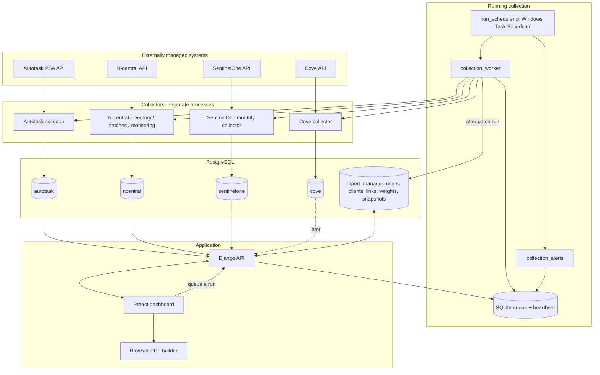
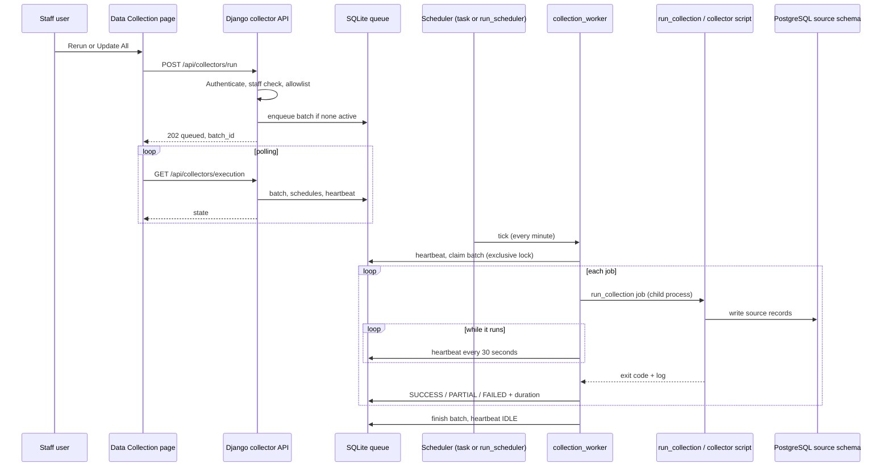
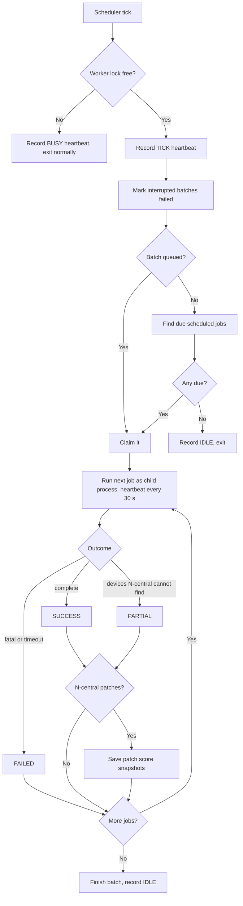
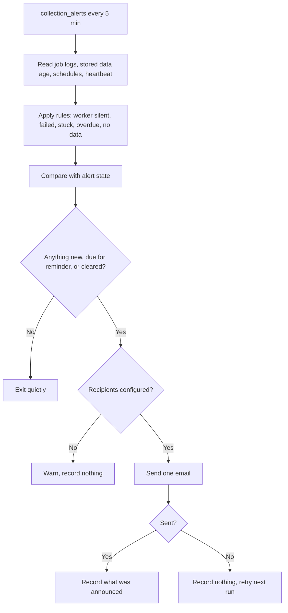
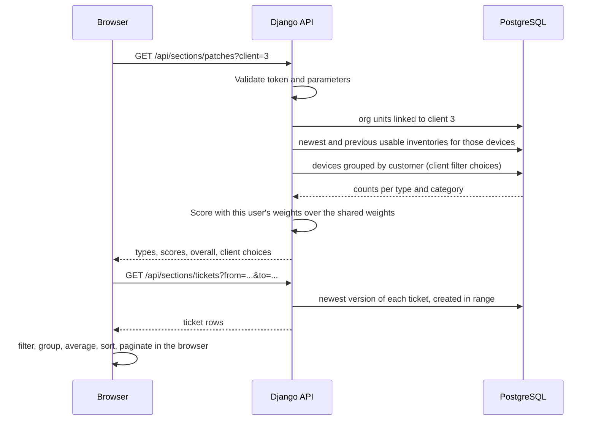
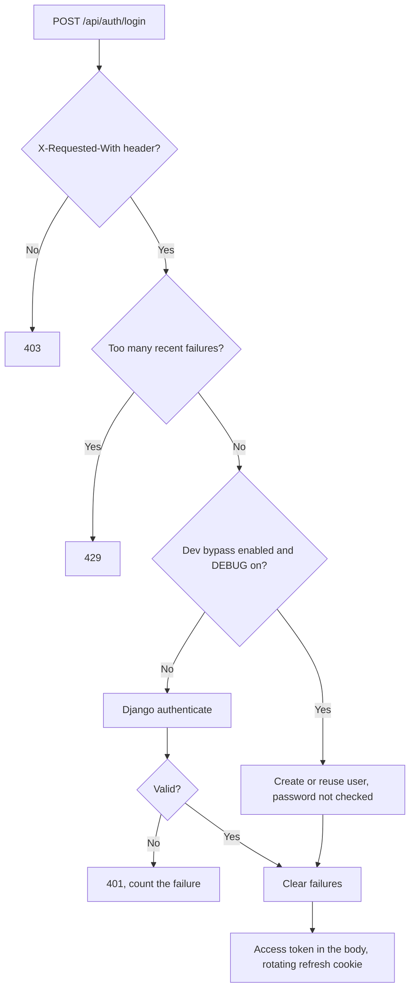
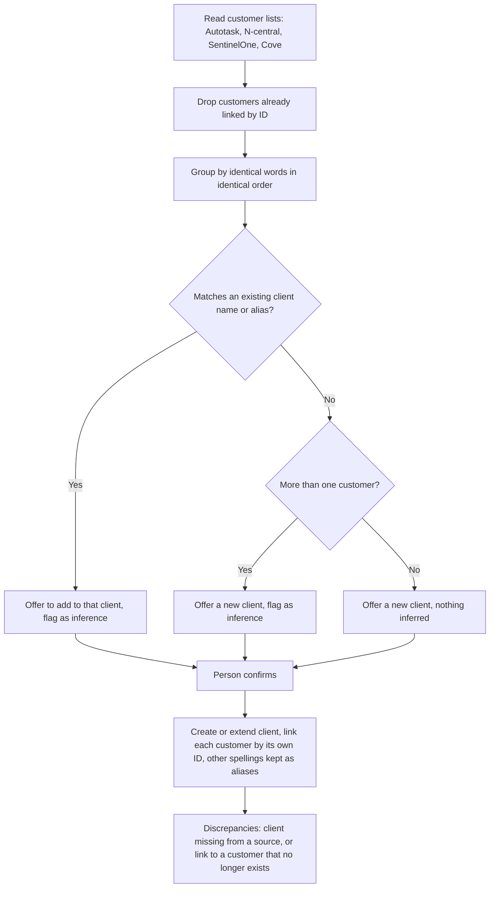
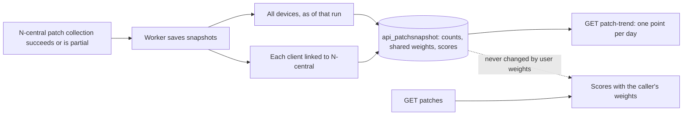
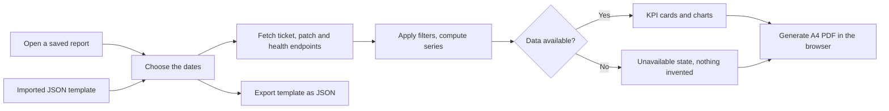
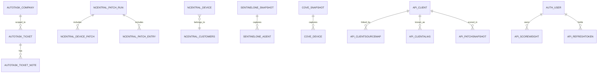

# 2. Interaction diagrams and flowcharts

Diagrams reflect the **assembled code**; differences in a deployed environment need validation. They are standard [Mermaid](https://mermaid.js.org/) and are also stored as `.mmd` files in `diagrams/`.

## A. Logical architecture

## B. Manual rerun and worker lifecycle

## C. Worker tick decisions

## D. Alerts

## E. Dashboard request

## F. Authentication

## G. Client resolution

## H. Patch scores and trend

## I. Report configuration and PDF export

## J. Main relationships

This is a summary. The complete entity-relationship diagrams, generated from the real definitions, are in [`09_ER_DIAGRAMS.md`](09_ER_DIAGRAMS.md).

`API_CLIENTSOURCEMAP` links by ID across schemas (`source` + `external_id`) and is not a database foreign key to the source tables. Consult [`04_DATA_MODEL.md`](04_DATA_MODEL.md) before changing constraints.
