# 9. Entity-relationship diagrams

Generated from the real definitions by `docs/tools/generate_er.py`: the collectors' `sql/schema.sql` files and the Django models. `backend/api/test_docs.py` fails if these files are out of date, so run `python docs/tools/generate_er.py` after changing a schema or a model.

**Reading them.** The Mermaid diagrams here show **key columns only** (primary and foreign keys), so they stay readable; the images and the tables list every column. A solid line is a foreign key the database enforces. A **dashed line is a link that exists in the data but is not enforced**: for example, N-central `patch_entry` has no foreign key to `device`, and every cross-schema link is by ID.

Contents: [Autotask](#autotask), [N-central](#n-central), [SentinelOne](#sentinelone), [Cove](#cove), [Application (report_manager)](#application-report-manager), [across schemas](#across-schemas), [the master client list](#the-joinable-master-client-list).

## Autotask

Source: `Collector/AutotaskLight-main/sql/schema.sql`. 6 table(s), 6 view(s). Solid arrows are foreign keys declared in the definition; dashed arrows are links that exist in the data but are not enforced.

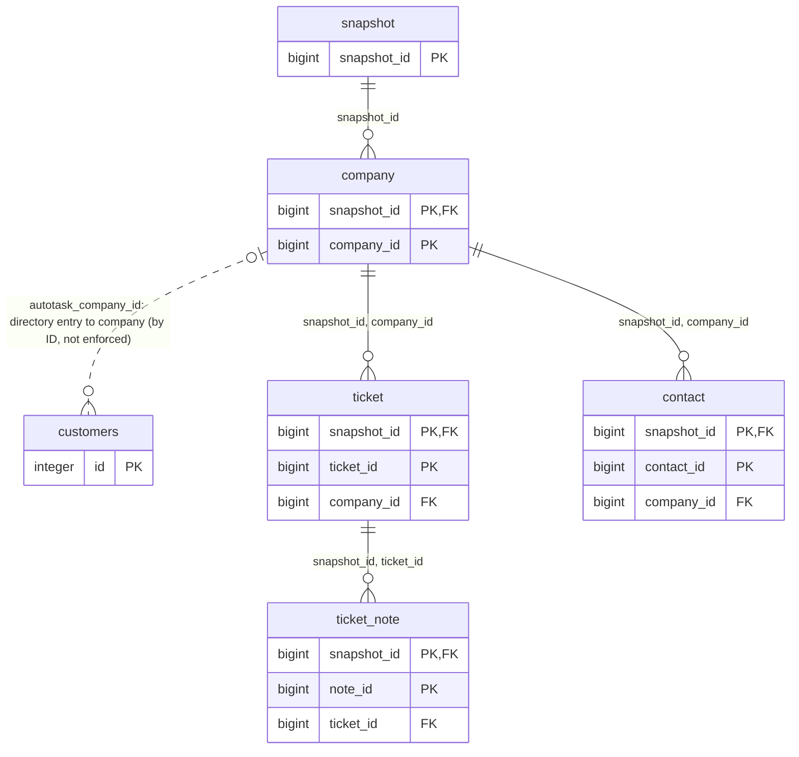

Complete column list with types: 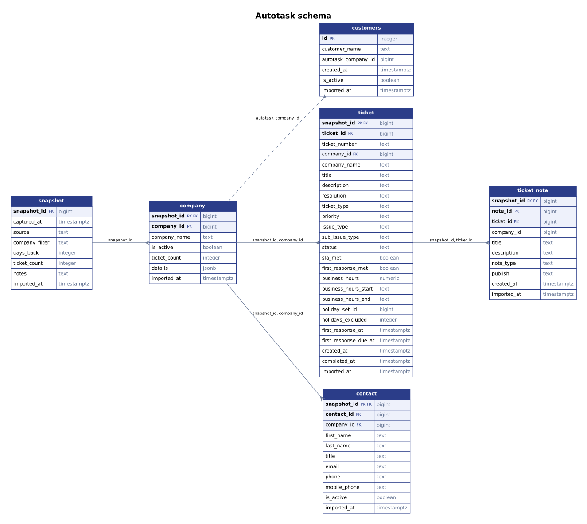 ([SVG](diagrams/er_autotask.svg)).

| Table | Primary key | Declared foreign keys | Columns |
|---|---|---|---|
| `customers` | id | — | 6: `id`, `customer_name`, `autotask_company_id`, `created_at`, `is_active`, `imported_at` |
| `snapshot` | snapshot_id | — | 8: `snapshot_id`, `captured_at`, `source`, `company_filter`, `days_back`, `ticket_count`, `notes`, `imported_at` |
| `company` | snapshot_id, company_id | (snapshot_id) → `snapshot` | 7: `snapshot_id`, `company_id`, `company_name`, `is_active`, `ticket_count`, `details`, `imported_at` |
| `ticket` | snapshot_id, ticket_id | (snapshot_id, company_id) → `company` | 25: `snapshot_id`, `ticket_id`, `ticket_number`, `company_id`, `company_name`, `title`, `description`, `resolution`, `ticket_type`, `priority`, `issue_type`, `sub_issue_type`, `status`, `sla_met`, `first_response_met`, `business_hours`, `business_hours_start`, `business_hours_end`, `holiday_set_id`, `holidays_excluded`, `first_response_at`, `first_response_due_at`, `created_at`, `completed_at`, `imported_at` |
| `ticket_note` | snapshot_id, note_id | (snapshot_id, ticket_id) → `ticket` | 10: `snapshot_id`, `note_id`, `ticket_id`, `company_id`, `title`, `description`, `note_type`, `publish`, `created_at`, `imported_at` |
| `contact` | snapshot_id, contact_id | (snapshot_id, company_id) → `company` | 11: `snapshot_id`, `contact_id`, `company_id`, `first_name`, `last_name`, `title`, `email`, `phone`, `mobile_phone`, `is_active`, `imported_at` |

Views: `v_latest_snapshot`, `v_company_latest`, `v_ticket_latest`, `v_ticket_note_latest`, `v_contact_latest`, `v_company_summary`.

- Rows are **snapshot-scoped**: `ticket` and `contact` reference `company` by `(snapshot_id, company_id)`, and `ticket_note` references `ticket` by `(snapshot_id, ticket_id)`. Joins must carry the snapshot ID.
- `customers` is the list of companies to load (`autotask_company_id` is the stable ID); it is not snapshot-scoped.
- The `v_*` views return the latest snapshot. There is no assignee column on `ticket` (see [`05_OPERATIONS.md`](05_OPERATIONS.md), Technician data).

## N-central

Source: `Collector/ncentralAPI-main/sql/schema.sql`. 13 table(s), 21 view(s). Solid arrows are foreign keys declared in the definition; dashed arrows are links that exist in the data but are not enforced.

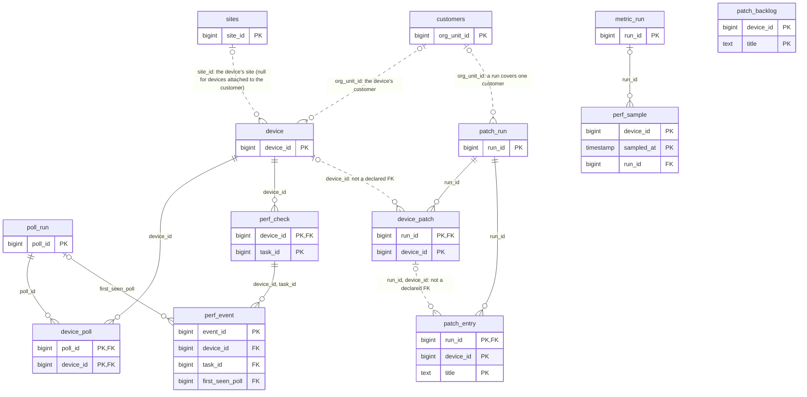

Complete column list with types: 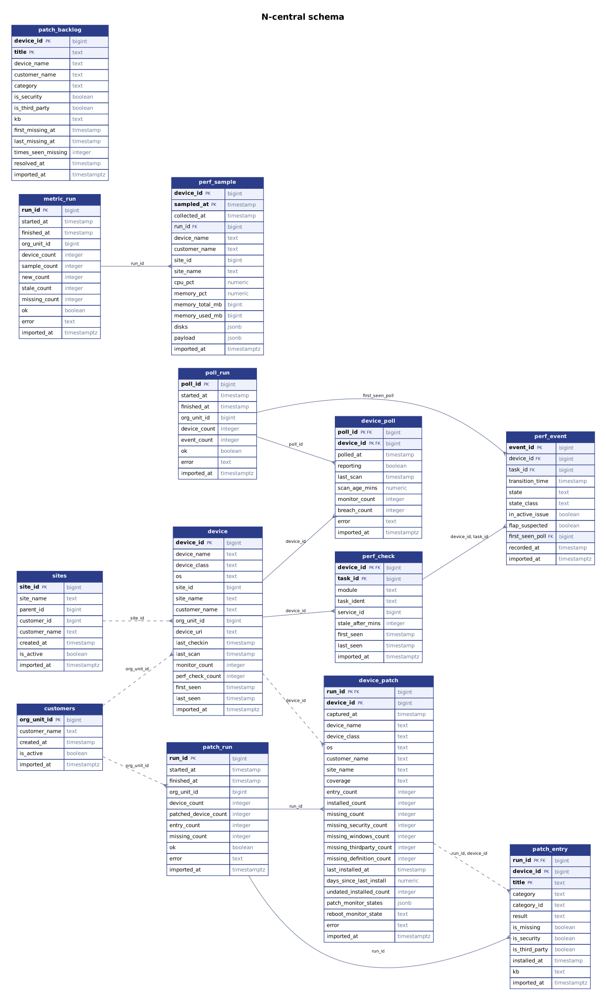 ([SVG](diagrams/er_ncentral.svg)).

| Table | Primary key | Declared foreign keys | Columns |
|---|---|---|---|
| `customers` | org_unit_id | — | 5: `org_unit_id`, `customer_name`, `created_at`, `is_active`, `imported_at` |
| `sites` | site_id | — | 8: `site_id`, `site_name`, `parent_id`, `customer_id`, `customer_name`, `created_at`, `is_active`, `imported_at` |
| `device` | device_id | — | 16: `device_id`, `device_name`, `device_class`, `os`, `site_id`, `site_name`, `customer_name`, `org_unit_id`, `device_uri`, `last_checkin`, `last_scan`, `monitor_count`, `perf_check_count`, `first_seen`, `last_seen`, `imported_at` |
| `poll_run` | poll_id | — | 9: `poll_id`, `started_at`, `finished_at`, `org_unit_id`, `device_count`, `event_count`, `ok`, `error`, `imported_at` |
| `device_poll` | poll_id, device_id | (poll_id) → `poll_run`<br>(device_id) → `device` | 10: `poll_id`, `device_id`, `polled_at`, `reporting`, `last_scan`, `scan_age_mins`, `monitor_count`, `breach_count`, `error`, `imported_at` |
| `perf_check` | device_id, task_id | (device_id) → `device` | 9: `device_id`, `task_id`, `module`, `task_ident`, `service_id`, `stale_after_mins`, `first_seen`, `last_seen`, `imported_at` |
| `perf_event` | event_id | (first_seen_poll) → `poll_run`<br>(device_id, task_id) → `perf_check` | 11: `event_id`, `device_id`, `task_id`, `transition_time`, `state`, `state_class`, `in_active_issue`, `flap_suspected`, `first_seen_poll`, `recorded_at`, `imported_at` |
| `metric_run` | run_id | — | 12: `run_id`, `started_at`, `finished_at`, `org_unit_id`, `device_count`, `sample_count`, `new_count`, `stale_count`, `missing_count`, `ok`, `error`, `imported_at` |
| `perf_sample` | device_id, sampled_at | (run_id) → `metric_run` | 15: `device_id`, `sampled_at`, `collected_at`, `run_id`, `device_name`, `customer_name`, `site_id`, `site_name`, `cpu_pct`, `memory_pct`, `memory_total_mb`, `memory_used_mb`, `disks`, `payload`, `imported_at` |
| `patch_run` | run_id | — | 11: `run_id`, `started_at`, `finished_at`, `org_unit_id`, `device_count`, `patched_device_count`, `entry_count`, `missing_count`, `ok`, `error`, `imported_at` |
| `device_patch` | run_id, device_id | (run_id) → `patch_run` | 23: `run_id`, `device_id`, `captured_at`, `device_name`, `device_class`, `os`, `customer_name`, `site_name`, `coverage`, `entry_count`, `installed_count`, `missing_count`, `missing_security_count`, `missing_windows_count`, `missing_thirdparty_count`, `missing_definition_count`, `last_installed_at`, `days_since_last_install`, `undated_installed_count`, `patch_monitor_states`, `reboot_monitor_state`, `error`, `imported_at` |
| `patch_entry` | run_id, device_id, title | (run_id) → `patch_run` | 12: `run_id`, `device_id`, `title`, `category`, `category_id`, `result`, `is_missing`, `is_security`, `is_third_party`, `installed_at`, `kb`, `imported_at` |
| `patch_backlog` | device_id, title | — | 13: `device_id`, `title`, `device_name`, `customer_name`, `category`, `is_security`, `is_third_party`, `kb`, `first_missing_at`, `last_missing_at`, `times_seen_missing`, `resolved_at`, `imported_at` |

Views: `v_measured_until`, `v_perf_current`, `v_device_current`, `v_device_uptime_30d`, `v_perf_interval`, `v_perf_30d`, `v_device_perf_30d`, `v_site_perf_30d`, `v_perf_sample_current`, `v_perf_sample_daily`, `v_perf_pressure_7d`, `v_disk_free_current`, `v_disk_free_daily`, `v_metric_collector_health`, `v_device_patch_current`, `v_patch_summary`, `v_patch_backlog_open`, `v_patch_by_type`, `v_patch_trend`, `v_collector_health`, `v_patch_collector_health`.

- `patch_entry` references `patch_run` only. There is **no declared foreign key** from `patch_entry` or `device_patch` to `device`, nor from `patch_entry` to `device_patch`; the dashed links show the relationships the queries rely on.
- `device.org_unit_id` is the **customer** org unit: every collector fetches devices per customer (`get_devices_for_org_unit`) and writes that ID there. `device.site_id` is the site, and is null for devices attached directly to the customer.
- A patch run belongs to one customer (`patch_run.org_unit_id`). Usable inventories are per `(run_id, device_id)` in `device_patch` (`error` null, coverage not `unavailable`).

## SentinelOne

Source: `Collector/SentinelOne-main/sql/schema.sql`. 14 table(s), 10 view(s). Solid arrows are foreign keys declared in the definition; dashed arrows are links that exist in the data but are not enforced.

```mermaid
erDiagram
  customers {
    bigint id PK
  }
  snapshot {
    bigint snapshot_id PK
  }
  customer_month {
    bigint snapshot_id PK, FK
    text customer_name PK
  }
  threat {
    bigint snapshot_id PK, FK
    text threat_id PK
    text customer_name FK
  }
  agent {
    bigint snapshot_id PK, FK
    text agent_id PK
    text customer_name FK
  }
  threat_class {
    bigint snapshot_id PK, FK
    text customer_name PK, FK
    text classification PK
  }
  mitre_tactic {
    bigint snapshot_id PK, FK
    text customer_name PK, FK
    text tactic PK
  }
  top_threat {
    bigint snapshot_id PK, FK
    text customer_name PK, FK
    text threat_name PK
  }
  top_device {
    bigint snapshot_id PK, FK
    text customer_name PK, FK
    text device_name PK
  }
  top_user {
    bigint snapshot_id PK, FK
    text customer_name PK, FK
    text process_user PK
  }
  lolbin {
    bigint snapshot_id PK, FK
    text customer_name PK, FK
    text threat_name PK
  }
  daily_trend {
    bigint snapshot_id PK, FK
    text customer_name PK, FK
    date trend_date PK
  }
  os_spread {
    bigint snapshot_id PK, FK
    text customer_name PK, FK
    text os_name PK
  }
  agent_version {
    bigint snapshot_id PK, FK
    text customer_name PK, FK
    text agent_version PK
  }
  snapshot ||--o{ customer_month : "snapshot_id"
  customer_month ||--o{ threat : "snapshot_id, customer_name"
  customer_month ||--o{ agent : "snapshot_id, customer_name"
  customer_month ||--o{ threat_class : "snapshot_id, customer_name"
  customer_month ||--o{ mitre_tactic : "snapshot_id, customer_name"
  customer_month ||--o{ top_threat : "snapshot_id, customer_name"
  customer_month ||--o{ top_device : "snapshot_id, customer_name"
  customer_month ||--o{ top_user : "snapshot_id, customer_name"
  customer_month ||--o{ lolbin : "snapshot_id, customer_name"
  customer_month ||--o{ daily_trend : "snapshot_id, customer_name"
  customer_month ||--o{ os_spread : "snapshot_id, customer_name"
  customer_month ||--o{ agent_version : "snapshot_id, customer_name"
  customers |o..o{ agent : "site_id: by site ID, not enforced"
```

Complete column list with types: 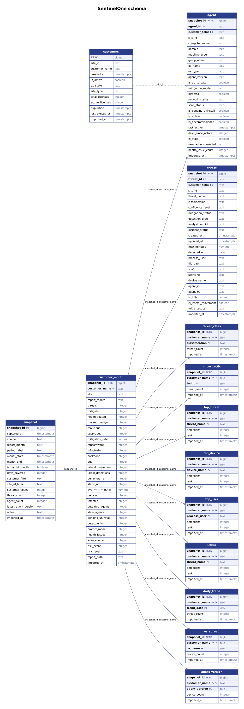 ([SVG](diagrams/er_sentinelone.svg)).

| Table | Primary key | Declared foreign keys | Columns |
|---|---|---|---|
| `customers` | id | — | 12: `id`, `site_id`, `customer_name`, `created_at`, `is_active`, `s1_state`, `site_type`, `total_licenses`, `active_licenses`, `expiration`, `last_synced_at`, `imported_at` |
| `snapshot` | snapshot_id | — | 17: `snapshot_id`, `captured_at`, `source`, `report_month`, `period_label`, `month_start`, `month_end`, `is_partial_month`, `days_covered`, `customer_filter`, `site_id_filter`, `customer_count`, `threat_count`, `agent_count`, `latest_agent_version`, `notes`, `imported_at` |
| `customer_month` | snapshot_id, customer_name | (snapshot_id) → `snapshot` | 33: `snapshot_id`, `customer_name`, `site_id`, `report_month`, `threats`, `mitigated`, `not_mitigated`, `marked_benign`, `malicious`, `suspicious`, `mitigation_rate`, `ransomware`, `infostealer`, `backdoor`, `pua`, `lateral_movement`, `lolbin_detections`, `behavioral_ai`, `static_ai`, `avg_mttr_minutes`, `devices`, `infected`, `outdated_agents`, `stale_agents`, `pending_uninstall`, `detect_only`, `protect_mode`, `health_issues`, `scan_aborted`, `risk_score`, `risk_level`, `report_path`, `imported_at` |
| `threat` | snapshot_id, threat_id | (snapshot_id, customer_name) → `customer_month` | 26: `snapshot_id`, `threat_id`, `customer_name`, `site_id`, `threat_name`, `classification`, `confidence_level`, `mitigation_status`, `detection_type`, `analyst_verdict`, `incident_status`, `created_at`, `updated_at`, `mttr_minutes`, `detected_on`, `process_user`, `file_path`, `sha1`, `storyline`, `device_name`, `agent_id`, `agent_os`, `is_lolbin`, `is_lateral_movement`, `mitre_tactics`, `imported_at` |
| `agent` | snapshot_id, agent_id | (snapshot_id, customer_name) → `customer_month` | 25: `snapshot_id`, `agent_id`, `customer_name`, `site_id`, `computer_name`, `domain`, `machine_type`, `group_name`, `os_name`, `os_type`, `agent_version`, `is_up_to_date`, `mitigation_mode`, `infected`, `network_status`, `scan_status`, `is_pending_uninstall`, `is_active`, `is_decommissioned`, `last_active`, `days_since_active`, `is_stale`, `user_actions_needed`, `health_issue_count`, `imported_at` |
| `threat_class` | snapshot_id, customer_name, classification | (snapshot_id, customer_name) → `customer_month` | 5: `snapshot_id`, `customer_name`, `classification`, `threat_count`, `imported_at` |
| `mitre_tactic` | snapshot_id, customer_name, tactic | (snapshot_id, customer_name) → `customer_month` | 5: `snapshot_id`, `customer_name`, `tactic`, `threat_count`, `imported_at` |
| `top_threat` | snapshot_id, customer_name, threat_name | (snapshot_id, customer_name) → `customer_month` | 6: `snapshot_id`, `customer_name`, `threat_name`, `detections`, `rank`, `imported_at` |
| `top_device` | snapshot_id, customer_name, device_name | (snapshot_id, customer_name) → `customer_month` | 6: `snapshot_id`, `customer_name`, `device_name`, `detections`, `rank`, `imported_at` |
| `top_user` | snapshot_id, customer_name, process_user | (snapshot_id, customer_name) → `customer_month` | 6: `snapshot_id`, `customer_name`, `process_user`, `detections`, `rank`, `imported_at` |
| `lolbin` | snapshot_id, customer_name, threat_name | (snapshot_id, customer_name) → `customer_month` | 6: `snapshot_id`, `customer_name`, `threat_name`, `detections`, `rank`, `imported_at` |
| `daily_trend` | snapshot_id, customer_name, trend_date | (snapshot_id, customer_name) → `customer_month` | 5: `snapshot_id`, `customer_name`, `trend_date`, `threat_count`, `imported_at` |
| `os_spread` | snapshot_id, customer_name, os_name | (snapshot_id, customer_name) → `customer_month` | 5: `snapshot_id`, `customer_name`, `os_name`, `device_count`, `imported_at` |
| `agent_version` | snapshot_id, customer_name, agent_version | (snapshot_id, customer_name) → `customer_month` | 5: `snapshot_id`, `customer_name`, `agent_version`, `device_count`, `imported_at` |

Views: `v_latest_snapshot`, `v_customer_month_latest`, `v_customer_current`, `v_current_snapshot_ids`, `v_threat_latest`, `v_agent_latest`, `v_red_flag_latest`, `v_portfolio_month`, `v_customer_trend`, `v_coverage_gaps`.

- Almost every table references `customer_month` by `(snapshot_id, customer_name)`, which in turn belongs to a `snapshot`. The customer is identified by **name** inside a snapshot; `customers.site_id` is the stable ID and `agent.site_id` carries it.

## Cove

Source: `Collector/Cove-main/sql/schema.sql`. 6 table(s), 6 view(s). Solid arrows are foreign keys declared in the definition; dashed arrows are links that exist in the data but are not enforced.

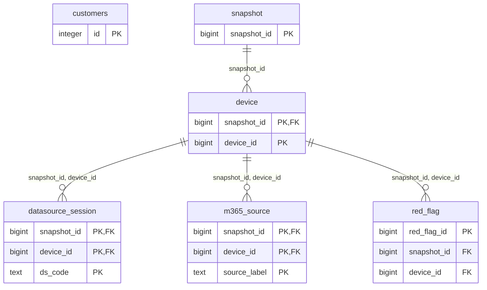

Complete column list with types: 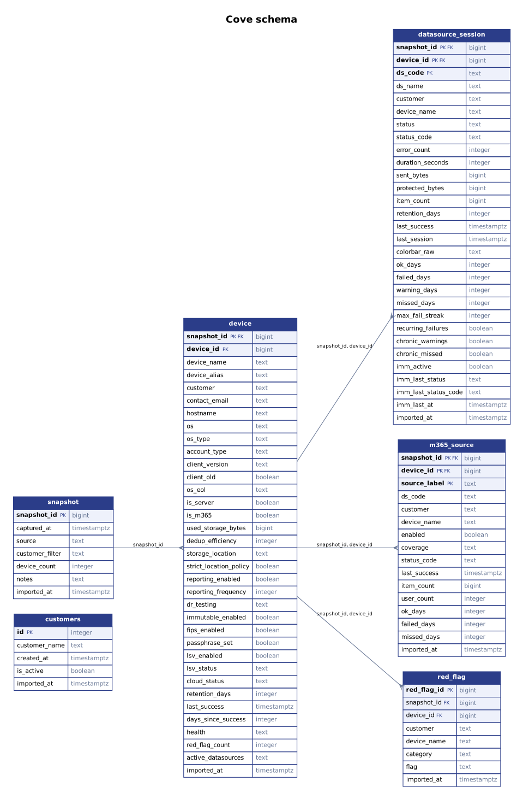 ([SVG](diagrams/er_cove.svg)).

| Table | Primary key | Declared foreign keys | Columns |
|---|---|---|---|
| `customers` | id | — | 5: `id`, `customer_name`, `created_at`, `is_active`, `imported_at` |
| `snapshot` | snapshot_id | — | 7: `snapshot_id`, `captured_at`, `source`, `customer_filter`, `device_count`, `notes`, `imported_at` |
| `device` | snapshot_id, device_id | (snapshot_id) → `snapshot` | 35: `snapshot_id`, `device_id`, `device_name`, `device_alias`, `customer`, `contact_email`, `hostname`, `os`, `os_type`, `account_type`, `client_version`, `client_old`, `os_eol`, `is_server`, `is_m365`, `used_storage_bytes`, `dedup_efficiency`, `storage_location`, `strict_location_policy`, `reporting_enabled`, `reporting_frequency`, `dr_testing`, `immutable_enabled`, `fips_enabled`, `passphrase_set`, `lsv_enabled`, `lsv_status`, `cloud_status`, `retention_days`, `last_success`, `days_since_success`, `health`, `red_flag_count`, `active_datasources`, `imported_at` |
| `datasource_session` | snapshot_id, device_id, ds_code | (snapshot_id, device_id) → `device` | 30: `snapshot_id`, `device_id`, `ds_code`, `ds_name`, `customer`, `device_name`, `status`, `status_code`, `error_count`, `duration_seconds`, `sent_bytes`, `protected_bytes`, `item_count`, `retention_days`, `last_success`, `last_session`, `colorbar_raw`, `ok_days`, `failed_days`, `warning_days`, `missed_days`, `max_fail_streak`, `recurring_failures`, `chronic_warnings`, `chronic_missed`, `imm_active`, `imm_last_status`, `imm_last_status_code`, `imm_last_at`, `imported_at` |
| `m365_source` | snapshot_id, device_id, source_label | (snapshot_id, device_id) → `device` | 16: `snapshot_id`, `device_id`, `source_label`, `ds_code`, `customer`, `device_name`, `enabled`, `coverage`, `status_code`, `last_success`, `item_count`, `user_count`, `ok_days`, `failed_days`, `missed_days`, `imported_at` |
| `red_flag` | red_flag_id | (snapshot_id, device_id) → `device` | 8: `red_flag_id`, `snapshot_id`, `device_id`, `customer`, `device_name`, `category`, `flag`, `imported_at` |

Views: `v_latest_snapshot`, `v_device_latest`, `v_datasource_latest`, `v_m365_latest`, `v_red_flag_latest`, `v_customer_summary`.

- Every load is a `snapshot`; nothing is updated in place. `customers` is the list of customers to load and is read, never written, by the loader. Devices carry the customer as text, with no ID link to `customers`.
- Not yet loaded against a live system.

## Application (report_manager)

Source: Django models (`backend/api/models.py`) plus Django's `auth_user`. 13 table(s). Solid arrows are foreign keys declared in the definition; dashed arrows are links that exist in the data but are not enforced.

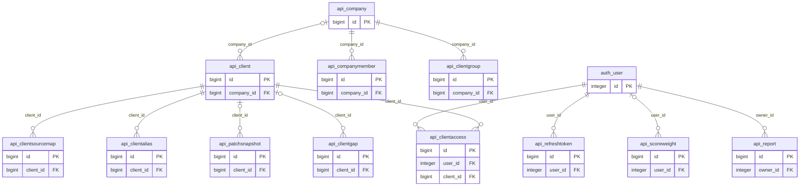

Complete column list with types: 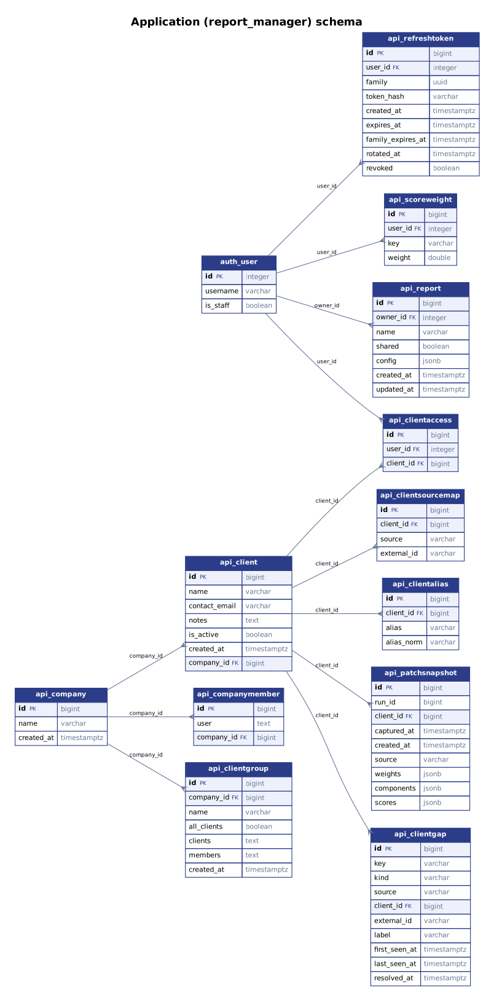 ([SVG](diagrams/er_report_manager.svg)).

| Table | Primary key | Declared foreign keys | Columns |
|---|---|---|---|
| `api_refreshtoken` | id | (user_id) → `auth_user` | 9: `id`, `user_id`, `family`, `token_hash`, `created_at`, `expires_at`, `family_expires_at`, `rotated_at`, `revoked` |
| `api_client` | id | (company_id) → `api_company` | 7: `id`, `name`, `contact_email`, `notes`, `is_active`, `created_at`, `company_id` |
| `api_clientsourcemap` | id | (client_id) → `api_client` | 4: `id`, `client_id`, `source`, `external_id` (unique (source, external_id)) |
| `api_clientalias` | id | (client_id) → `api_client` | 4: `id`, `client_id`, `alias`, `alias_norm` |
| `api_scoreweight` | id | (user_id) → `auth_user` | 4: `id`, `user_id`, `key`, `weight` (unique (user_id, key) where (user__isnull=False)) (unique (key) where (user__isnull=True)) |
| `api_patchsnapshot` | id | (client_id) → `api_client` | 9: `id`, `run_id`, `client_id`, `captured_at`, `created_at`, `source`, `weights`, `components`, `scores` (unique (run_id, client_id) where (client__isnull=False)) (unique (run_id) where (client__isnull=True)) |
| `api_report` | id | (owner_id) → `auth_user` | 7: `id`, `owner_id`, `name`, `shared`, `config`, `created_at`, `updated_at` (unique (owner, name)) |
| `api_clientgap` | id | (client_id) → `api_client` | 10: `id`, `key`, `kind`, `source`, `client_id`, `external_id`, `label`, `first_seen_at`, `last_seen_at`, `resolved_at` (unique (key) where (resolved_at__isnull=True)) |
| `api_clientaccess` | id | (user_id) → `auth_user`<br>(client_id) → `api_client` | 3: `id`, `user_id`, `client_id` (unique (user_id, client_id)) |
| `api_company` | id | — | 3: `id`, `name`, `created_at` |
| `api_companymember` | id | (company_id) → `api_company` | 3: `id`, `user`, `company_id` |
| `api_clientgroup` | id | (company_id) → `api_company` | 7: `id`, `company_id`, `name`, `all_clients`, `clients`, `members`, `created_at` (unique (company, name)) |
| `auth_user` | id | — | 3: `id`, `username`, `is_staff` (Django's own user table (only its key columns are shown)) |

- These tables are created by `python manage.py migrate`. Django also owns `auth_*` and `django_*` tables, not shown.
- `api_clientsourcemap` links a client to a customer in another schema by **ID text**, not a database foreign key (see the cross-schema diagram).
- `api_patchsnapshot` keeps `client_id` null for the all-devices snapshot; its `weights`, `components` and `scores` are JSON.

## Across schemas

No database foreign key crosses a schema. The master client (`api_client`) ties the schemas together through `api_clientsourcemap`, whose `external_id` holds each system's own ID as text: Autotask `company_id`, N-central `org_unit_id` (the customer), SentinelOne `site_id`, Cove `customers.id`. Names are never a join key.

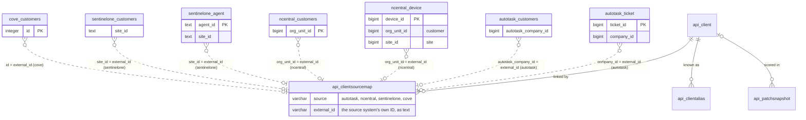

A join from a source table to its client therefore casts the ID to text:

```sql
SELECT c.name, d.device_name
FROM ncentral.device d
JOIN report_manager.api_clientsourcemap m ON m.source = 'ncentral' AND m.external_id = d.org_unit_id::text
JOIN report_manager.api_client c ON c.id = m.client_id;
```

## The joinable master client list

A **view** (not a table), `client_master`, with one row per client and an array of references per schema, so that any source table can be joined to the client in one step without going through the link table. Arrays, because one client can have several N-central org units. It is created on request with `python manage.py client_master_view` (PostgreSQL only; `--sql` prints it, `--drop` removes it) and is built from the link table, so it is always current. DATA-03 in [`06_STATUS_AND_BACKLOG.md`](06_STATUS_AND_BACKLOG.md).

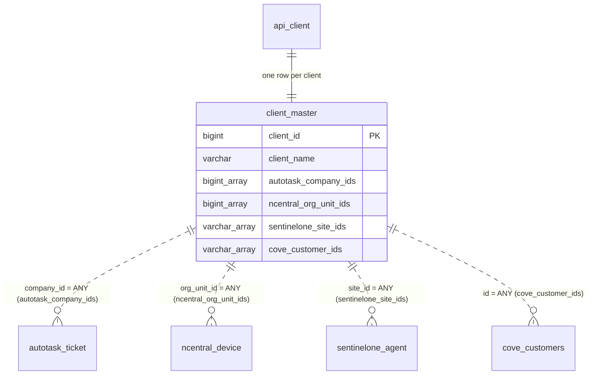
