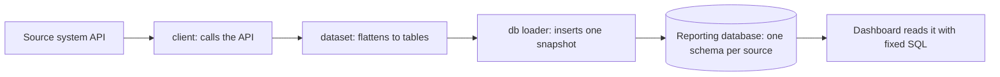

# Collectors guide

The collectors are the programs that fetch data from the source systems and put it in the reporting database. The dashboard never talks to the source systems itself: it **reads what the collectors stored**. This guide covers the four collectors, how the dashboard runs and judges them, and how to add one. Running them day to day is in [`05_OPERATIONS.md`](05_OPERATIONS.md); the tables they fill are in [`04_DATA_MODEL.md`](04_DATA_MODEL.md) and [`09_ER_DIAGRAMS.md`](09_ER_DIAGRAMS.md).

> **These are your programs.** The four folders under `Collector/` came from you and were not changed to build the dashboard (the one file added near them, `AutotaskLight-main/sql/proposed/technician.sql`, is a proposal that has **not** been applied). Their own READMEs remain the authority on each one's options; this guide explains how they fit together and what the dashboard does with them.

## The pattern all four share

- **client → dataset → loader.** The *client* calls the source's API; the *dataset* layer turns the nested answers into flat, database-shaped tables (and can also feed CSV or Excel); the *loader* writes them.
- **Insert-only, one snapshot per run.** Each run adds a snapshot row and stamps every row it writes with it. Nothing is updated or deleted, so history builds up and a bad run can be told apart.
- **The schema is made first, by you.** Each folder has `sql/schema.sql`; the loaders do not create or change tables (SentinelOne's `sync-customers` is the one exception: it maintains its customer roster).
- **A roster drives each run.** Every collector reads a `customers` table in its own schema to know whose data to fetch, so adding or pausing a customer is a row, not a code change.
- **The dashboard only reads.** It queries these schemas with fixed SQL and never writes to them.

## Overview

| Collector | Folder | Source | Schema | Dashboard job(s) |
|---|---|---|---|---|
| N-central | `Collector/ncentralAPI-main` | SolarWinds N-central REST API | `ncentral` | `ncentral_inventory`, `ncentral_patches`, `ncentral_monitoring` |
| Autotask | `Collector/AutotaskLight-main` | Autotask PSA REST API | `autotask` | `autotask_tickets` |
| SentinelOne | `Collector/SentinelOne-main` | SentinelOne management console (`/web/api/v2.1`) | `sentinelone` | `sentinelone_monthly` |
| Cove | `Collector/Cove-main` | Cove Data Protection API | `cove` | `cove_backup` |

What each one gives the dashboard:

| Dashboard page | Comes from |
|---|---|
| Overview, patch details, trend | N-central: `ncentral.patch_run`, `device_patch`, `patch_entry`, and `device` and `customers` for who owns which devices |
| Server Health | SentinelOne: `sentinelone.agent` (with `customers`, `snapshot`) |
| Backups | Cove: `cove.device`, `red_flag`, `snapshot`, `customers` |
| Client Tickets, Technician Tickets | Autotask: `autotask.ticket` (with `customers`, `snapshot`); the technician page also probes `autotask.resource`, which the loader does not fill yet |
| Data Collection | Not the data itself: the collectors' run logs, and a freshness check on each schema |

## N-central (`Collector/ncentralAPI-main`)

**What it does.** Reads from the N-central REST API (it only reads; the one `POST` is signing in) and records the customers, the devices, each device's patch status, and monitoring state.

**Signing in.** The only credential kept is the long-lived `NCENTRAL_API_TOKEN`. The client posts it to `/api/auth/authenticate` and gets a short-lived access token, and signs in again from scratch when that expires (it does not use the refresh endpoint). `NCENTRAL_API_BASE_URL` is the server.

**Customers.** N-central has no customers endpoint: `GET /api/org-units` returns service organisations, customers and sites together, told apart by `orgUnitType`. `ncentral_clients.py` writes the customers to `ncentral.customers`, **the table both collectors read to know whose devices to fetch**; `ncentral_sites.py` keeps the sites and works out which customer each belongs to by walking up the parents.

| Dashboard job | Runs | What it fetches and writes |
|---|---|---|
| `ncentral_inventory` | `ncentral_inventory.py` | The device inventory, using only the org-unit and device-list calls. Writes `ncentral.device` |
| `ncentral_patches` | `ncentral_patch.py collect` | Each device's patch inventory (about 200 KB per device, so run it **daily**, not hourly). Writes `ncentral.patch_run`, `device_patch`, `patch_entry` and `patch_backlog` |
| `ncentral_monitoring` | `ncentral_observability.py monitoring` | A safe wrapper over the performance and metrics collectors: whether each device reported, and each monitor's state changes. Writes `ncentral.poll_run`, `device_poll`, `perf_check`, `perf_event`, `metric_run` and `perf_sample` |

**Things worth knowing**

- `device.org_unit_id` is the **customer's** org unit; `site_id` is the site, and is empty for devices attached straight to a customer. The dashboard links a client to its devices through the customer org units.
- A patch entry is classed as **security**, **Windows** or **third-party** from `is_security`, `is_third_party` and its category; Defender definition updates are not scored. These are the three measures on the Overview.
- **Server Health uses two of these tables for each server's patching:** `patch_entry` for the date of the newest install in each category, and `patch_backlog` for what is still missing and for how long. It finds the device by **computer name inside the same client**, because SentinelOne and N-central share no ID.
- `patch_backlog` records when a patch was **first seen missing** by this collector. The API gives no date for a missing patch, so ages are floors, not exact.
- The REST API exposes monitor **state**, not measured values. `ncentral_metrics.py` and `amp_perf_sample.ps1` (the property named by `NCENTRAL_PERF_PROPERTY`) exist to get CPU, RAM and disk, but **the dashboard does not read them**, which is why Server Health shows "No data" for those.
- `NCENTRAL_PG_DSN` is the database connection; `NCENTRAL_PATCH_LOG_FILE` redirects the patch collector's own log; `NCENTRAL_JWT` is read only by `test_connection.py` (it falls back to `NCENTRAL_API_TOKEN`, which is the same credential).
- **A patch run can be PARTIAL**: if the only failures are devices whose assets answer `404 DeviceNotFoundException`, the run is recorded as partial, not failed, and the Data Collection page says Partial (hover for how many devices). Decided 12 Nov 2026 (NC-01): **N-central cannot find those devices, so each one counts as disconnected**, and Server Health says so on that device's card, with the date of its last successful inventory. The run still collected every other device's inventory, so it counts as a good run for freshness and for the saved score history. Nothing is deleted.
- From 9 November the N-central jobs failed with connect timeouts to the N-central server on port 443, as their logs showed. That was an **N-central outage** (you confirmed it on 12 November, and it is back), not the code: the collector is the one you supplied. The Overview's scores and the "data as of" line were from the last good run on 9 November until a new run succeeds, so run the three N-central jobs once from the Data Collection page to bring them up to date.

**By hand.** `python test_connection.py` (signs in and lists a few customers, using raw calls so the handshake itself can be debugged), `python smoke_test.py`, and the wrappers `collect_patches.cmd`, `collect_metrics.cmd` and `collect_performance.cmd`. The tests are in `tests/`.

## Autotask (`Collector/AutotaskLight-main`)

**What it does.** Reads Autotask tickets (and the companies, contacts and notes around them) and records them. The API client uses only the Python standard library; the database loader needs the packages in `requirements.txt`.

**Settings** (in a `.env` read from the **folder you run it in**): `AUTOTASK_USERNAME`, `AUTOTASK_SECRET`, `AUTOTASK_INTEGRATION_CODE`. `AUTOTASK_BASE_URL` is optional: if blank, the client finds your zone by calling `zoneInformation`. `AUTOTASK_PG_DSN` is the database connection.

**Using it.** The command line has `zone`, `companies`, `company`, `tickets` and `fields`, and it can be used as a library; the README documents each.

| Dashboard job | Runs | Notes |
|---|---|---|
| `autotask_tickets` | `autotask_db.py load-active --days 120 --limit 500` | Loads the last 120 days of tickets for each **active** customer in `autotask.customers`, up to 500 per customer. **Disabled by default.** It has no dry-run mode, and the dashboard refuses to pass one |

**Things worth knowing**

- The loader fills `autotask.snapshot`, `company`, `ticket`, `ticket_note`, `contact` and `customers`.
- **Technician data is not collected.** The ticket table has no assigned technician, so the Technician Tickets page cannot show who has what. A proposed change is in `Collector/AutotaskLight-main/sql/proposed/technician.sql` and has **not** been applied; it needs your approval and a working Autotask connection (TICK-02).
- **One failing customer fails the whole run.** `load-active` reports a customer that fails and carries on with the rest, but exits with 1 if any failed, so the dashboard records the run as failed even though the other customers loaded.
- The last reported run had two `401` responses and one `500` (an Autotask-side SMTP setting), and nothing loaded; the job has never had a good run. That is on the Autotask side (credentials and a setting), not the dashboard: the Data Collection page shows the latest reason, and `python autotask_client.py zone` (from the folder) is the quickest check that the credentials work.

## SentinelOne (`Collector/SentinelOne-main`)

**What it does.** Reads the SentinelOne console and computes, per customer and month, the figures of the monthly EDR report: threats by classification and engine, MITRE tactics, living-off-the-land binaries, time to resolve, endpoint health, protection mode, and a risk score with its band. It can also write the monthly report as text.

**Settings:** `SENTINELONE_BASE_URL` and `SENTINELONE_API_TOKEN` (in a `.env` next to the scripts), and the database connection `SENTINELONE_PG_DSN`. The loader also accepts `S1_PG_DSN`, `IPC_PG_DSN` or `COVE_PG_DSN`, so the value need not be written twice (it is the same database Cove writes to, in a different schema).

| Part | File | Job |
|---|---|---|
| API client | `s1_client.py` | Authentication, paging, the `{data, pagination}` wrapper; no analysis |
| Metrics | `s1_metrics.py` | Everything derived from raw threats and agents, matching the report generator section for section |
| Dataset | `s1_dataset.py` | Flattens the results into database rows |
| Loader | `s1_db.py` | `sync-customers`, `customers`, `load-active`, and single-customer loads |
| Report | `generate_monthly_reports.py`, `Generate-MonthlyReports.ps1` | The text reports (the Python is a port of the PowerShell) |

| Dashboard job | Runs | Notes |
|---|---|---|
| `sentinelone_monthly` | `s1_db.py load-active` | One run for each active customer in `sentinelone.customers`. Enabled, but not scheduled by default (it is a monthly job). No dry-run mode |

**Things worth knowing**

- **`sentinelone.customers` is the control surface.** `sync-customers` fills it from the console; set `is_active = false` on a row to drop that site from automated runs without losing its history (a later sync will not quietly switch it back on).
- The tables are `snapshot`, `customer_month`, `threat`, `agent`, `threat_class`, `mitre_tactic`, `top_threat`, `top_device`, `top_user`, `lolbin`, `daily_trend`, `os_spread`, `agent_version` and `customers`.
- **Server Health reads only `sentinelone.agent`** (name, customer, connected or not, infected, up to date, machine type). CPU, RAM and disk are not in the SentinelOne data, which is why those show "No data".

## Cove (`Collector/Cove-main`)

**What it does.** Reads the Cove Data Protection API and appends one snapshot per customer. It never changes Cove.

**Settings:** `COVE_USERNAME`, `COVE_PASSWORD`, `COVE_PARTNER` and the database connection `COVE_PG_DSN` (in `.env`; see `.env.example`).

| Part | File | Job |
|---|---|---|
| API client | `cove_client.py` | Calls the API |
| Analysis | `cove_agent.py` | Backup health and session status per device and customer, red flags (recurring failures, missed backups, errors), 28-day history (chronic or one-off failures), and server disaster-recovery testing gaps |
| Dataset and loader | `cove_dataset.py`, `cove_db.py` | Flattens and loads; `cove_db.py customers` lists who will be loaded and `load-active` loads one snapshot per active customer |

| Dashboard job | Runs | Notes |
|---|---|---|
| `cove_backup` | `cove_db.py load-active` | Loads every active customer in `cove.customers`. **Add customers with an `INSERT`** (`INSERT INTO cove.customers (customer_name) VALUES ('Acme');`). It has no dry-run mode, and the dashboard refuses to pass one |

**Things worth knowing**

- The tables are `snapshot`, `device`, `datasource_session`, `m365_source`, `red_flag` and `customers`; the Backups page reads `device`, `red_flag`, `snapshot` and `customers`.
- A device is linked to a client by the Cove customer's own ID where possible, then by name through an alias. A device whose customer matches no client shows on the Backups page, but is not linked to a client.
- The first live run (10 November) succeeded: 11 devices, all linked to a client.

## How the dashboard runs them

**The jobs.** Each job is a fixed entry in the allowlist `JOB_COMMANDS` in `backend/api/management/commands/run_collection.py`: a name, the folder it runs in, the script and its arguments. Nothing else can be run, and no part of a request can change what is run.

| Job | Folder | Script and arguments | Dry run |
|---|---|---|---|
| `ncentral_inventory` | `ncentral` | `ncentral_inventory.py` | supported |
| `ncentral_patches` | `ncentral` | `ncentral_patch.py collect` | supported |
| `ncentral_monitoring` | `ncentral` | `ncentral_observability.py monitoring` | supported |
| `autotask_tickets` | `autotask` | `autotask_db.py load-active --days 120 --limit 500` | refused (it would run for real) |
| `sentinelone_monthly` | `sentinelone` | `s1_db.py load-active` | refused |
| `cove_backup` | `cove` | `cove_db.py load-active` | refused |

**Your settings for them** are in `backend/collector_jobs.json` (your copy of `collector_jobs.example.json`, which an archive never overwrites): `source_directories` says where each collector folder is, and each job has `enabled`, `schedule_enabled`, `interval_minutes`, `timeout_seconds` and extra `args`. The shipped defaults:

| Job | Enabled | Scheduled | Every | Timeout |
|---|---|---|---|---|
| `ncentral_inventory` | yes | yes | 24 hours | 20 minutes |
| `ncentral_patches` | yes | yes | 24 hours | 30 minutes |
| `ncentral_monitoring` | yes | yes | 1 hour | 30 minutes |
| `autotask_tickets` | no | no | 24 hours | 60 minutes |
| `sentinelone_monthly` | yes | no | 7 days | 60 minutes |
| `cove_backup` | no | no | 24 hours | 30 minutes |

**Three ways to run them** (details and the exact set-up are in `05_OPERATIONS.md`): `python manage.py run_collection <job>` once, by hand or from Task Scheduler; the **worker** (`collection_worker`), which takes requests from the **Run** buttons on the Data Collection page; or `run_scheduler`, one process that does both on a timer. A collector is **never** started inside the web server. A lock stops two copies of one job running at once.

**What is recorded.** Each run appends lines to `backend/logs/collectors/<job>.log`, such as `2026-11-10T08:20:51Z SUCCESS job=cove_backup duration_seconds=2.3 exit_code=0 dry_run=False`. The status is `START`, `SUCCESS`, `PARTIAL` or `FAILED`. A non-zero exit is **failed**, with one exception: an N-central patch run whose only problems are confirmed device-not-found warnings is **partial**. Anything unrecognised alongside a non-zero exit is failed, never partial.

**How freshness is judged.** The dashboard shows how old each job's data is **from the last good run in the log** (a SUCCESS or PARTIAL that was not a dry run), not from whether the latest run failed: a failure leaves the data as old as it was and says how many failures there have been since. If a job has no good run in the log, it falls back to the newest timestamp in its own schema (the *stored data*), and says so:

**Who sees it.** Administrators see all of this on the Data Collection page. Everyone signed in sees just the age of each page's data (a time, a state and a count of failed runs, from `GET /api/freshness`) as the "data as of" line under each page's heading. How old is too old is the job's `interval_minutes` in `collector_jobs.json`.

| Job | Fallback: newest value of |
|---|---|
| `ncentral_inventory` | `ncentral.device.last_seen` |
| `ncentral_patches` | `ncentral.patch_run.finished_at` |
| `ncentral_monitoring` | `ncentral.poll_run.finished_at` |
| `autotask_tickets` | `autotask.snapshot.captured_at` |
| `sentinelone_monthly` | `sentinelone.snapshot.captured_at` |
| `cove_backup` | `cove.snapshot.captured_at` |

**Alerts and heartbeat.** The worker records a heartbeat every 30 seconds while a job runs, so a stuck worker is visible. Each problem (a failing or overdue job) is emailed **once**, repeated as a reminder (daily, by default) while it lasts, and announced again when it clears; it is only recorded as sent after the email has really gone, so a failed send is retried on the next run (`collection_alerts`; the settings are in the operations guide). The raw log of a run can be opened from the Data Collection page.

## The tables each collector fills

Every table also has an **`imported_at`** column (DATA-01, approved 12 Nov 2026): the time the row was written to the database, empty for rows stored before it was added. See "Applying `imported_at`" in `05_OPERATIONS.md`.

These are every table in each source schema, as described in `sql/schema.sql`; the relationships are drawn in [`09_ER_DIAGRAMS.md`](09_ER_DIAGRAMS.md).

| Collector | Tables |
|---|---|
| N-central | `ncentral.customers`, `ncentral.sites`, `ncentral.device`, `ncentral.poll_run`, `ncentral.device_poll`, `ncentral.perf_check`, `ncentral.perf_event`, `ncentral.metric_run`, `ncentral.perf_sample`, `ncentral.patch_run`, `ncentral.device_patch`, `ncentral.patch_entry`, `ncentral.patch_backlog` |
| Autotask | `autotask.customers`, `autotask.snapshot`, `autotask.company`, `autotask.ticket`, `autotask.ticket_note`, `autotask.contact` |
| SentinelOne | `sentinelone.customers`, `sentinelone.snapshot`, `sentinelone.customer_month`, `sentinelone.threat`, `sentinelone.agent`, `sentinelone.threat_class`, `sentinelone.mitre_tactic`, `sentinelone.top_threat`, `sentinelone.top_device`, `sentinelone.top_user`, `sentinelone.lolbin`, `sentinelone.daily_trend`, `sentinelone.os_spread`, `sentinelone.agent_version` |
| Cove | `cove.customers`, `cove.snapshot`, `cove.device`, `cove.datasource_session`, `cove.m365_source`, `cove.red_flag` |

## Adding a collector or a job

1. **The collector.** Put it in `Collector/<name>/` with a `sql/schema.sql` that makes its own schema, an insert-only loader that writes one snapshot per run, and a `customers` roster table that decides whose data to fetch.
2. **Allow it to run.** Add it to `JOB_COMMANDS` in `run_collection.py` (and to `NO_DRY_RUN` if its script ignores a dry-run flag).
3. **Teach the dashboard its name and freshness.** Add it to `JOB_NAMES` and `JOB_LABELS` in `backend/api/collection_health_core.py`, give it a query in `SOURCE_QUERIES` in `backend/api/collection_freshness.py`, and add its label to `NAMES` in `frontend/src/pages/CollectionHealth.jsx`.
4. **Configure it.** Add it to `backend/collector_jobs.example.json`, **disabled**, and tell people to switch it on in their own `collector_jobs.json`.
5. **Document it.** Add it to this guide; regenerate the diagrams and the source index (`python docs/tools/generate_er.py`, `generate_source_index.py`). `backend/api/test_docs.py` fails until each of these is done.

## When a job fails

1. **Open the Data Collection page.** It shows each job's latest status, the last good run and how many failures since, and the raw log can be opened (by an administrator; by the platform owner once client access is enforced).
2. **Read the first error in the log.** A timeout or connection error is the network or the credentials, not the code. A `401` is the credential. A `404` on a device is the N-central partial case above.
3. **Check the connection from the machine the backend runs on:** `Test-NetConnection <host> -Port 443` and `nslookup <host>` (PowerShell), or open the address in a browser; for N-central `python test_connection.py` from its folder.
4. **After a fix, run the job once** from the Data Collection page, then run `python manage.py verify_data`: it checks every dashboard section against the real data and shows each collector's last good run.

## Known gaps

| Gap | Where |
|---|---|
| Whether an N-central patch run with device-not-found warnings counts as healthy | NC-01 in `06_STATUS_AND_BACKLOG.md` (a decision for you) |
| Technician data is not collected from Autotask | TICK-02 (needs your approval and a working Autotask connection) |
| Rows carry the time of their snapshot but not the time they were imported | DATA-01 (needs your approval to change the source schemas) |
| The N-central patch **schedule** (next patch window) is not collected | SERVER-02 (blocks the Server Health "Next Due") |
| CPU, RAM and disk are not collected in a form the dashboard reads | Server Health shows "No data" until one is |
