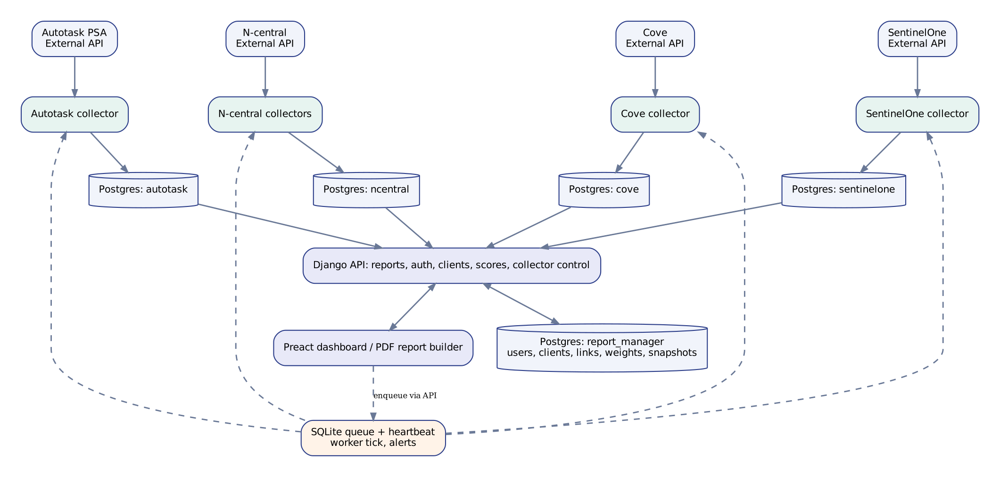
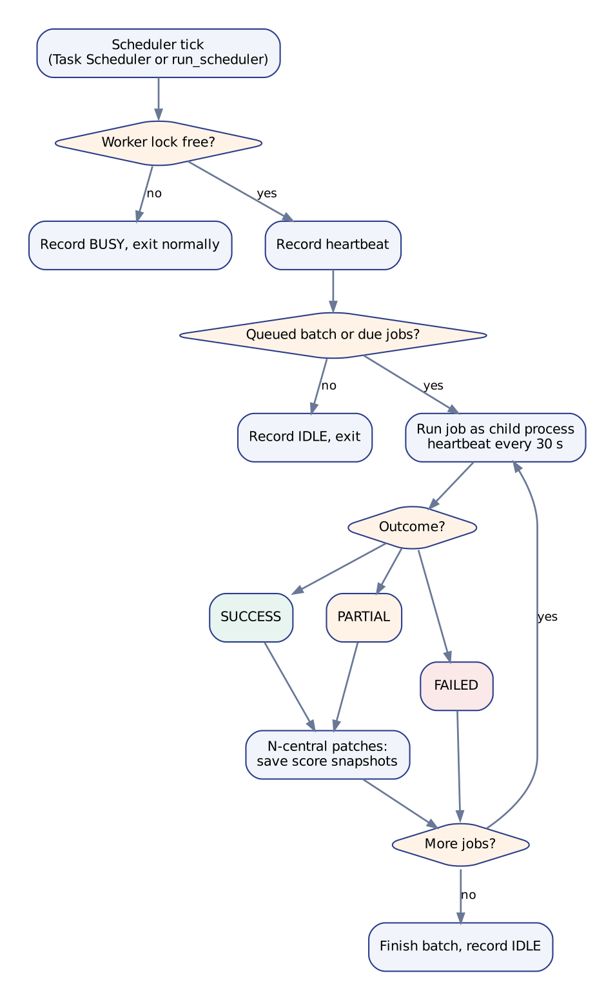

Code-based handover | 12 November 2026 | Documentation v3.0

Evidence basis: the project archive (`ops-dashboard-49`), the four collector projects and their schema files, the real-data check run on 10 November, and the decisions made up to 12 November. Nothing in this document was run against your live systems by its author: what it says about live behaviour comes from what you reported. The author has also looked at the main pages in a headless browser, using the real backend's output for test data (12 November), which found and fixed four layout defects; none of it has been seen with your live data, so each item that matters says whether you still need to look. The full developer reference is the Markdown pack in the `docs` folder; the complete API is in `08_API_REFERENCE.md`.

# Executive overview

The reporting platform has four upstream sources (Autotask, N-central, SentinelOne, Cove), a PostgreSQL multi-schema store, a Django API for reports, accounts, clients, scores and collector control, a Preact dashboard with a browser-generated PDF report, and a separate collection worker driven by a local SQLite queue. It is built for the owner's own use first; making it available to other people and other companies is deliberately parked (section 8).

- **All four collectors have run.** Cove's first live run succeeded on 10 November. Autotask is disabled because it fails on the Autotask side, so ticket pages are empty until that is fixed.
- **Collection runs unattended** through either one command (`python manage.py run_scheduler`) or two Windows scheduled tasks. A heartbeat shows the worker is alive, and email alerts report failures, overdue data and a silent worker.
- **Every page says how old its data is.** Each shows a "data as of" line taken from the last good collection run, and says "Stale" with the number of failed runs since when a source is overdue.
- **Clients** are matched across systems by each system's own ID, with a resolution page that groups unlinked customers by identical name words and flags that as an inference.
- **Patch scores** are calculated on the server (shared weights with personal overrides) and saved after each patch collection, so trends are real history. The Overview explains how the weights make the score, with the working for one client.
- **Servers** are shown as cards with two connection statuses (SentinelOne's and N-central's) and Performance, Patches and Data Collected sections. A device that N-central cannot find is shown as disconnected from N-central.
- **Access control:** collector and client management are staff-only. Per-client access, companies and **client groups** (a named list of clients, or all of a company's) are built but **switched off by default**; nothing is enforced until you choose to. Administrators make people from the Access page: no password is chosen for them, they get a one-time link to choose their own.

# 1. Architecture

{width=6.2in}

The source-specific PostgreSQL schemas are read directly with schema-qualified queries, read-only. The `report_manager` schema holds Django and application records (users, clients and their links, score weights, score snapshots, client gaps, per-client access and companies). A SentinelOne endpoint and an N-central device share no ID, so they are matched by **computer name inside the same client**, never by name alone.

# 2. What the dashboard shows

| Page | What it is for |
|----------|-----------------------------------|
| **Overview** | The Overall Score for one client, a trend, the three patch types and their categories, Scores By Client, and the Score Weights panel with "How is the score calculated?" |
| **Server Health** | Five tiles that filter (Servers, SentinelOne Disconnected, N-central Disconnected, Infected, Out Of Date: only the bad ones are asked about), a **client filter** and a **multi-device filter**, a sort box (worst first by default) and a card per endpoint. Each card shows **SentinelOne Status** and **N-central Status** and has three sections that open on their own headings: **Performance** (CPU, RAM, disk: "No data" until a source exists), **Patches** (a table of the three categories: Last Added, Next Due, Up To Date) and **Data Collected** (the latest date found for the device on each collector) |
| **Backups** | Six tiles (Warning, Critical and **Red Flags** filter when clicked), a client filter and a multi-device filter, charts, a table worst first (critical, warning, OK; then the longest since a good backup; then the most red flags) and a device detail card |
| **Client Tickets, Technician Tickets** | Ticket tiles, charts, a volume trend, filters and a ticket table. Technician data is not collected yet |
| **Reports** | My Reports and Templates, an editor with a default period, and a PDF for chosen dates |
| **Data Collection** (staff) | Each collector's last run and freshness, buttons to run one, and its latest log |
| **Clients, Client Resolution** (staff) | The master client list (its Linked Customers column shows the customers' names, never their IDs), and grouping unlinked customers |
| **Access** (staff) | Three tabs. **Overview**: the people table, first, with each person's company, **Access (Admin or Employee)**, client groups and clients; and, for the platform owner, companies. **Employees**: make a new employee (with a one-time link to choose a password) and the accounts (new link, deactivate; never deleted). **Client Groups**: named lists of clients |
| **Settings** | Theme, layout, **saved date ranges** (a length such as "last 3 months" under a name you choose, kept in your browser) and remembered inputs |

# 3. Service ownership (proposed, requires confirmation)

| Service | Data / system owner | Implementation and operations |
|---------------|--------------------|--------------------|
| Autotask API | Autotask tenant owner (unconfirmed) | Reporting collector engineering |
| N-central API | N-central operations group (unconfirmed) | Collector engineering and operations |
| SentinelOne | Security/endpoint team (unconfirmed) | Collector engineering and security operations |
| Cove | Backup service owner (TBD) | Collector engineering and operations |
| PostgreSQL | Reporting / DB operations | DBA / platform team (TBD) |
| Django and Preact | Application product and engineering | Application team (TBD) |
| Scheduler, worker, alerts | Platform operations | Task owner and alert recipients (TBD) |
| Client master list | Reporting / product owner | Confirms groupings and resolves discrepancies |

No named owner or escalation path was established in the material supplied. Record an accountable person for every row before production signoff.

# 4. Collector lifecycle

{height=5.4in}

The dashboard queues requests; a running worker is required to execute them. Enabled jobs run one at a time and a failure does not stop the next job. The worker records a heartbeat every tick and every 30 seconds during a long job. After a successful or partial N-central patch collection it saves score snapshots.

Each run is recorded as **Success**, **Partial** or **Failed**. A run is Partial only when the sole problems are devices that N-central cannot find (a 404 on the device); anything the classifier does not recognise is a failure. Data freshness is judged from the **last good run** (a success or a partial run, never a failure or a dry run), so a failure never makes old data look fresh.

**Disconnected devices (decided 12 November).** A device that N-central cannot find counts as **disconnected**. The Data Collection page still says Partial for the run; the disconnection is shown per device on Server Health, as the **N-central Status** beside **SentinelOne Status** on each card (and on the Patches heading), with a note giving the date of the device's last *successful* inventory. The two statuses are independent: a server can be connected to SentinelOne and disconnected from N-central. Nothing is deleted.

# 5. Implemented modules and APIs

| Component | Path | Purpose |
|----------|------------------------------|--------------------|
| Reports | `GET /api/sections/{tickets, patches, patch-overview, patch-entries, patch-trend, server-health, backups, backup-detail}` | Source-backed report data, with per-client scoping |
| Freshness | `GET /api/freshness` | How old each page's data is (any signed-in user) |
| Authentication | `POST /api/auth/{login, refresh, logout, register, forgot, reset}` | Sign-in and account lifecycle, with throttling |
| Clients | `GET, POST /api/clients`, `PUT /api/clients/{id}` | Master clients with source links and aliases |
| Client resolution | `GET /api/clients/resolution`, `POST /api/clients/resolve` | Group, confirm and review discrepancies |
| Access | `GET /api/access`, `PUT /api/access/{username}` | Who may see which clients, and the clients given one by one |
| Client groups | `GET, POST /api/client-groups`, `PUT, DELETE /api/client-groups/{id}` | Named lists of clients, per company |
| People | `POST /api/users`, `PUT /api/users/{username}`, `POST /api/users/{username}/link` | Make, change, deactivate, and re-link a person |
| Score weights | `GET, PUT /api/weights` | Shared and personal weights |
| Collector control | `GET /api/collectors/{health, execution, <job>/latest-log}`, `POST /api/collectors/run` | Status, alerts, queue (staff) |
| Worker, scheduler, alerts | `collection_worker`, `run_scheduler`, `collection_alerts` | Run collectors and report problems |
| Snapshots | `snapshot_scores` | Save patch score history (`--backfill` rebuilds it) |
| Checks | `verify_data`, `client_access`, `company` | Check every section against the real databases; manage access and companies |

# 6. Data model

| Schema | Tables | Notes |
|--------------------|---------------|--------------------------------------------------|
| `autotask` | 6 | Ticket, company, contact and note snapshots. No assignee data is collected |
| `ncentral` | 13 | Inventory, patches, polling and performance runs |
| `sentinelone` | 14 | Monthly snapshots, agents, threats |
| `cove` | 6 | Customers to load, snapshots, devices, sessions, M365, red flags |
| `report_manager` | application | Django tables, including clients and links, score weights and snapshots, client gaps, per-client access, client groups, companies and refresh tokens |

**`imported_at` (approved 12 November, applied by you).** Every one of the 39 collector tables gets a column recording when each row was written to the database. Existing rows keep NULL on purpose ("imported before this was recorded"): nothing is stamped after the event. New rows get the insert time with no change to any collector. Apply each collector's `sql/migrations/2026-11-12_imported_at.sql` when no collector is running, then `python manage.py verify_data` shows whether it took. The dashboard works with or without it.

Missing CPU/RAM/disk samples, patch history before the first snapshot, the N-central patch schedule and ticket assignments stay unavailable rather than being invented.

Entity-relationship diagrams of every schema, and of the links between them, are in `09_ER_DIAGRAMS.md` (generated from the real definitions).

# 7. Observed operational outcomes (user-reported)

| Source | Last reported outcome | Implication |
|---------------|------------------------------|------------------------------|
| Real-data check (10 Nov) | 6 sections OK, 2 empty, 0 failed | The dashboard reads the real databases. Empty at that time: tickets (Autotask disabled) and the patch trend (no snapshots until `snapshot_scores --backfill` is run) |
| N-central | All three jobs failed from 9 November with connect timeouts: an N-central outage, confirmed over by you on 12 November | Scores and "data as of" are from the 9 November run until the three jobs are run again |
| N-central patches | 58 devices, 1,074 entries, 6 device assets 404 (9 Nov) | Partial: the 6 devices count as disconnected and are never read as compliant |
| Cove | First live run succeeded (10 Nov) | Backups page has real data |
| SentinelOne monthly | Succeeded (10 Nov) | Server Health has real data |
| Autotask | Nothing loaded; two HTTP 401, one HTTP 500 (an Autotask-side email setting) | Disabled until fixed upstream |
| N-central CPU/RAM/disk | `NO_DATA` for 27 devices | Not shown: Performance says "No data" |
| Browser check (12 Nov) | Server Health, the Overview and its score working, Data Collection and saved date ranges were driven in headless Chromium against the real backend's output on test data | Five layout defects found and fixed, one of them (the "data as of" line at the left edge on a wide window) first missed by the author and found by you from a screenshot; still to be looked at by you with live data |
| Your full test run (12 Nov) | 671 tests, 670 passed, **including every client group and people test on your database**; the one error was the documentation viewer's read-only test on Windows, which answered a refused write without reading it (fixed) | Run again to confirm the fix |
| Automated tests here | About 500 Python tests that need no database and over 330 JavaScript tests, all passing | The database-backed Django tests (`backend/api/tests.py`) can only be run on your machine: `python manage.py test` |

# 8. Decisions made by the owner

- **Priorities (11 Nov):** the owner's own use comes first; anything about other people or other companies is parked until the owner is happy.
- **What "healthy" means (12 Nov):** deliberately **not defined** for now, including whether all three patch categories count or only one. Server Health shows facts per category (Last Added, Next Due, Up To Date) and never an overall verdict. Per-device patch scores wait for this decision.
- **Disconnected devices (12 Nov):** a device N-central cannot find counts as disconnected, shown on Server Health; the collection run still says Partial.
- **`imported_at` (12 Nov):** approved and applied by you; existing rows stay empty. `verify_data` confirms it.
- **Two connection statuses (12 Nov):** one for SentinelOne and one for N-central, on each card and as separate tiles.
- **Saved date ranges:** kept in the browser, per person, not on the server.
- **Layout (12 Nov):** sizes are relative (`rem`, `em`, `%`, `vw`, `vh`), never pixels, and pages are laid out on a 12-column grid (`col-N`, mobile first), so the layout follows the window and the reader's text size. A test forbids pixel sizes.
- **Server health trend:** closed (12 Nov): the patch and ticket trends are what is wanted.
- **Client groups and people (12 Nov):** the access work was un-parked at the owner's request. A client group is a named list of clients; a person sees the clients of every group they are in, plus any given one by one. **What an access group is** (my default: a named set of the four rights) is waiting for the owner's answer. The Access page now has three tabs (Overview, Employees, Client Groups) with an Admin or Employee setting for each person.
- **On hold while the owner speaks with people (12 Nov):** collecting the technician on each ticket, and collecting the N-central patch schedule. Both keep saying "Not collected" and nothing is invented.

# 9. Outstanding work, in priority order

- **Yours, now:** confirm `imported_at` with `python manage.py verify_data`; run the three N-central jobs once so figures and "data as of" catch up after the outage; run `python manage.py snapshot_scores --backfill` if you have not already, so the trend has history; fix Autotask so tickets load; run `python manage.py migrate` (it adds the tables for client gaps, access, companies and client groups, and places you and every client in the first company; nothing is enforced), then `python manage.py test`, and tell me about any failure in the new client group and people tests.
- **P0, security and release:** run the database tests, confirm wrong passwords return 401, rotate credentials that were in shared archives, and work through the production release gates below.
- **P1, on hold:** technician data (needs Autotask working, then approval to collect it) and the N-central patch schedule (needs approval to collect it), which "Next Due" on Server Health waits for.
- **P1, left alone for now:** patch scores per device, and the definition of "healthy".
- **Next, as one piece of work:** access groups (ACC-17: my default is a named set of rights, awaiting your answer), the rights themselves, the rule that the Manage right needs every client of the company, a list of every route with the permission it needs, and navigation by rights. The other groups of work, and the decisions each waits for, are in `STAGED_PLAN.md`.
- **Parked until other people are added:** directors across branches, per-company score weights and report templates, moving a client between companies from the screen, and separate data sources per company. **Do not onboard an unrelated second organisation yet:** score weights and report templates are still shared by everyone.
- **P3:** refresh this document again after the next round of changes.

# 10. Production release gates

- Confirm the deployed version matches the archive, and review current `.env` values without disclosing secrets.
- `DJANGO_DEBUG=0`, a real secret key, HTTPS, `manage.py check --deploy` clean, staff authorization confirmed. Leave `DJANGO_CLIENT_ACCESS_ENFORCED` unset until other people are added, and set the platform owner (`python manage.py company owner <username>`) before ever enabling it.
- Validate source timestamps, SQL results, report KPI definitions and upstream request budgets.
- Run the scheduler without manual intervention; verify recovery after a reboot and that alerts arrive.
- Run the isolated Django tests, `npm test`, and the frontend production build (`npm run build`). `npm run check` (needs TypeScript installed once) finds build errors before the page is opened.
- Document backup and restore, log retention, and named owners and on-call contacts.

# 11. Where to find things

| You want | Look in |
|--------------------|---------------------------------------------|
| How the system fits together, flowcharts | `01_SYSTEM_OVERVIEW.md`, `02_FLOWCHARTS.md` |
| The code, the data model, the full API | `03_CODEBASE_AND_API.md`, `04_DATA_MODEL.md`, `08_API_REFERENCE.md`, `09_ER_DIAGRAMS.md` |
| Running and fixing it | `05_OPERATIONS.md` (including troubleshooting and applying `imported_at`) |
| What is done, open and decided | `06_STATUS_AND_BACKLOG.md`, `STAGED_PLAN.md` |
| What to try in a browser | `07_VERIFICATION_CHECKLIST.md` |
| The front end and the collectors in depth | `10_FRONTEND_GUIDE.md`, `11_COLLECTORS.md` |
